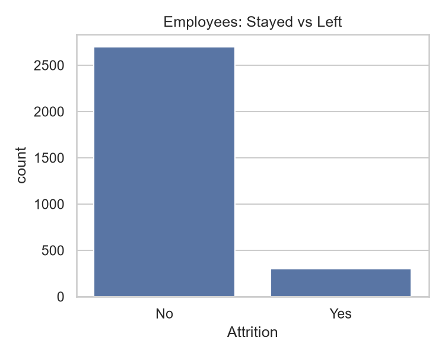
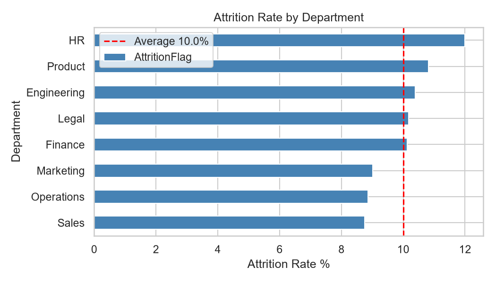
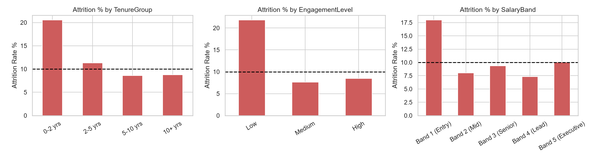
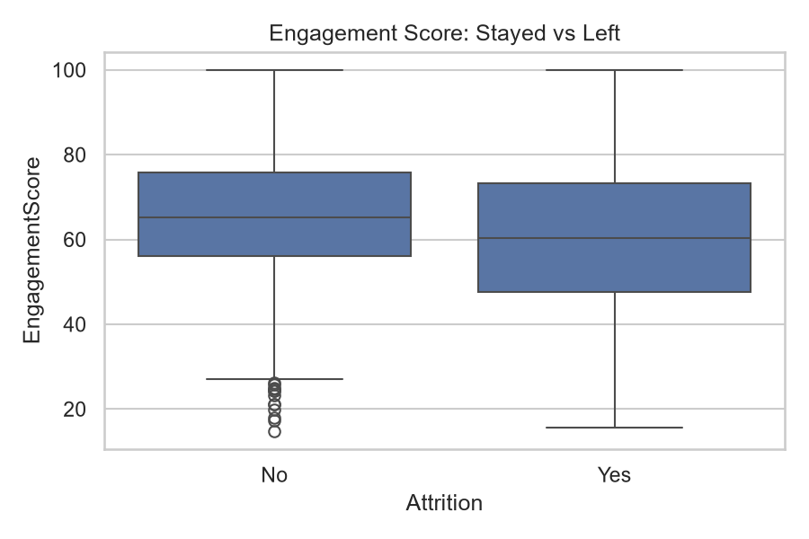
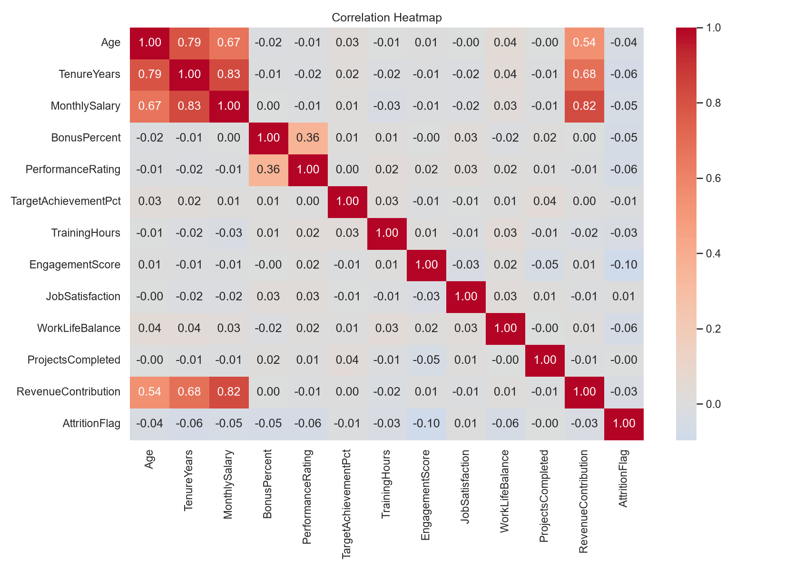

# HR Employee Attrition Analysis

A data analysis project (Rwad graduation project) that studies **why employees leave the company**.
The dataset contains **3,000 employees** across 8 departments, and about **10%** of them left the company.

## Project Goal
Answer one question: **who leaves the company, and why?**
(Is it related to salary, department, tenure, or engagement?)

## What the Project Does
The code is a pipeline made of small steps, each in its own file:

| Step | File | What it does |
|---|---|---|
| 1. Load | `hr_pipeline/data_loader.py` | Reads the raw data from the Excel file |
| 2. Clean | `hr_pipeline/data_cleaner.py` | Converts dates, creates `AttritionFlag` (1 = left, 0 = stayed), runs data quality checks |
| 3. Feature engineering | `hr_pipeline/feature_engineer.py` | Creates `AgeGroup`, `HireYear`, `YearsSincePromotion`, `TenureGroup`, `EngagementLevel`, `HighPerformer` |
| 4. Save | `main.py` | Saves the clean data to `data/processed/hr_clean.csv` |
| 5. Charts | `hr_pipeline/visualizer.py` | Draws 5 EDA charts and saves them in `outputs/charts/` |
| 6. Database | `hr_pipeline/database.py`, `summary_loader.py` | Loads the data and the summary sheets into SQL Server |
| 7. SQL queries | `hr_pipeline/queries.py`, `sql_main.py` | Runs basic and aggregate SQL queries |

`main.py` runs steps 1 to 6 in order. `sql_main.py` runs the SQL queries.

## Charts
| | |
|---|---|
|  |  |
|  |  |



## Tools Used
Python, pandas, matplotlib, seaborn, SQLAlchemy, SQL Server (T-SQL)

## How to Run

1. Install the libraries:
   ```
   pip install -r requirements.txt
   ```
2. **SQL Server setup** (needed for steps 6 and 7):
   - SQL Server installed on your machine, with an empty database named `HR_Project`:
     ```sql
     CREATE DATABASE HR_Project;
     ```
   - ODBC Driver 18 for SQL Server
   - The connection settings are in `hr_pipeline/config.py` (local server, Windows authentication). Change them if your setup is different.
3. Run the pipeline:
   ```
   python main.py
   ```
4. Run the SQL queries:
   ```
   python sql_main.py
   ```

## Project Structure
```
├── main.py
├── sql_main.py
├── requirements.txt
├── hr_pipeline/
│   ├── config.py
│   ├── data_loader.py
│   ├── data_cleaner.py
│   ├── feature_engineer.py
│   ├── visualizer.py
│   ├── database.py
│   ├── summary_loader.py
│   └── queries.py
├── data/
│   ├── raw/HR_Business_Performance.xlsx
│   └── processed/hr_clean.csv
└── outputs/charts/
```
